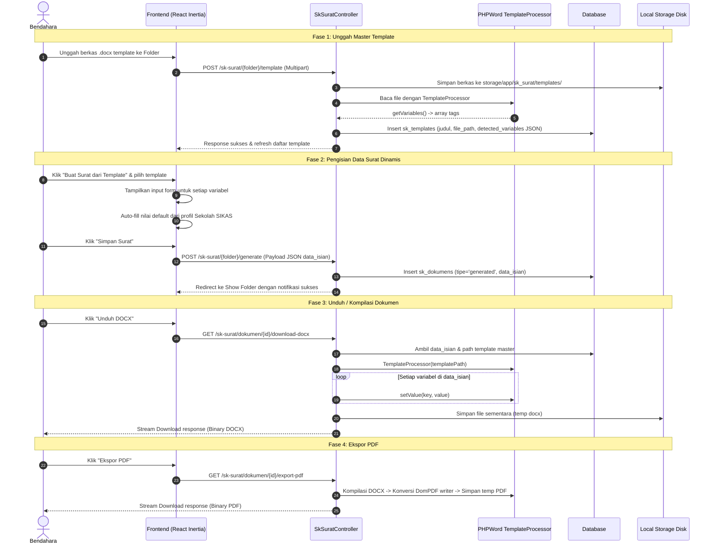

# Design Spec: Fitur SK & Surat (Manajemen Folder, Generator Dokumen PHPWord, dan Pengarsipan Sekolah)

**Tanggal:** 10 November 2026  
**Status:** In Review / Ready for Plan  
**Topik:** Fitur Pelengkap, Administrasi Persuratan Sekolah, Folder Manager, Generator PHPWord, Ekspor DOCX & PDF, Arsip Digital, RBAC  

---

## 1. Latar Belakang & Masalah

Di lingkungan sekolah, Bendahara BOSP dan staf administrasi tidak hanya mengelola pembukuan keuangan (BKU, Kwitansi, BAST, SPJ), tetapi juga bertanggung jawab menerbitkan dan mengarsipkan berbagai surat resmi serta Surat Keputusan (SK) penunjang BOSP, seperti:
1. **Surat Keputusan (SK):** SK Tim Manajemen BOSP Sekolah, SK Penetapan Bendahara Pengeluaran Pembantu, SK Tim Pengadaan Barang/Jasa, SK Panitia Kegiatan.
2. **Surat Tugas & Perjalanan Dinas:** Surat Tugas Kegiatan Belajar/Workshop, Surat Perjalanan Dinas (SPPD).
3. **Surat Resmi Lainnya:** Undangan Rapat Komite, Surat Permohonan, Surat Pemberitahuan.

**Masalah yang dihadapi saat ini:**
- Dokumen surat dan SK masih dibuat secara manual dan terpisah di Microsoft Word pada laptop masing-masing, rawan hilang, format tidak seragam, dan data sekolah (NPSN, nama kepala sekolah, nama bendahara) harus diketik ulang berulang kali.
- Belum ada ruang kerja (*workspace*) terpusat di aplikasi SIKAS bagi bendahara untuk mengorganisir dokumen persuratan ke dalam folder-folder tematik.
- Belum ada generator surat otomatis yang mampu mempertahankan tata letak (*layout*) resmi dokumen Word asli (kop surat, margin, tabel, format tanda tangan) sembari mempermudah pengisian data dinamis secara cepat melalui formulir web.

---

## 2. Solusi & Tujuan Desain

Fitur **"SK & Surat"** dirancang sebagai solusi terpadu di menu *Fitur Pelengkap* SIKAS:
1. **Manajemen Folder Bebas:** Bendahara dapat membuat, mengubah, dan menghapus folder secara fleksibel (global sekolah, tanpa terkunci tahun anggaran kaku) untuk mengelompokkan dokumen.
2. **Generator Dokumen Cerdas berbasis PHPWord:**
   - Bendahara dapat mengunggah master template `.docx` buatan sekolah yang berisi tag penanda variabel (misalnya: `${nomor_surat}`, `${nama_kegiatan}`, `${tanggal}`).
   - Sistem secara otomatis mendeteksi semua tag `${variabel}` di dalam file template menggunakan pustaka `phpoffice/phpword`.
   - Sistem secara cerdas melakukan *auto-fill* untuk variabel data standar sekolah (seperti `${nama_sekolah}`, `${npsn}`, `${alamat_sekolah}`, `${nama_kepala_sekolah}`, `${nip_kepala_sekolah}`, `${nama_bendahara}`, `${nip_bendahara}`) dari data profil sekolah SIKAS.
   - Variabel lainnya ditampilkan sebagai formulir input dinamis yang mudah diisi oleh bendahara di web.
   - Nilai isian formulir disimpan ke basis data sehingga bendahara dapat mengoreksi dan meng-*generate* ulang surat kapan saja tanpa memulai dari awal.
3. **Pilihan Output Ganda (DOCX & PDF):** Pengguna dapat langsung mengunduh hasil dokumen dalam format Word asli (`.docx`) untuk dibuka/diedit lanjut di Microsoft Word/WPS, atau mengekspor langsung menjadi file siap cetak (`.pdf`).
4. **Pengarsipan Berkas Mandiri (Upload Scan/Fisik):** Selain dokumen hasil generate, bendahara juga dapat mengunggah berkas fisik yang sudah ditandatangani dan distempel basah (format PDF, DOCX, atau scan gambar) ke dalam folder yang sama sebagai arsip digital sekolah.
5. **Dukungan RBAC (Role-Based Access Control):**
   - **Bendahara:** Akses penuh (membuat folder, mengunggah template, membuat surat, mengedit isian, menghapus dokumen/folder).
   - **Kepala Sekolah:** Akses *read-only* (melihat daftar folder, membaca ringkasan surat, dan mengunduh berkas DOCX/PDF).

---

## 3. Hak Akses & Peran Pengguna (RBAC)

| Aksi | Role Bendahara | Role Kepala Sekolah |
| :--- | :---: | :---: |
| Melihat menu "SK & Surat" di Sidebar | Ya | Ya |
| Melihat daftar folder dan detail isi folder | Ya | Ya |
| Mengunduh dokumen hasil generate (.docx / .pdf) | Ya | Ya |
| Mengunduh file arsip fisik yang diunggah | Ya | Ya |
| Membuat, mengedit, atau menghapus Folder | Ya | Tidak (Tombol Tersembunyi & Guard 403) |
| Mengunggah atau menghapus Master Template | Ya | Tidak (Tombol Tersembunyi & Guard 403) |
| Membuat atau mengubah isian formulir surat | Ya | Tidak (Tombol Tersembunyi & Guard 403) |
| Mengunggah file arsip scan baru | Ya | Tidak (Tombol Tersembunyi & Guard 403) |
| Menghapus dokumen surat / berkas arsip | Ya | Tidak (Tombol Tersembunyi & Guard 403) |

---

## 4. Rancangan Basis Data & Model

### 4.1 Tabel `sk_folders`
Menyimpan entitas folder:
- `id`: bigIncrements (PK)
- `nama_folder`: string (255)
- `deskripsi`: text (nullable)
- `warna`: string (50, default: `'indigo'`) — untuk estetika ikon folder di UI
- `created_by`: unsignedBigInteger (FK `users.id`, onDelete cascade)
- `created_at`, `updated_at`: timestamp

### 4.2 Tabel `sk_templates`
Menyimpan master template `.docx` yang diunggah ke dalam suatu folder:
- `id`: bigIncrements (PK)
- `folder_id`: unsignedBigInteger (FK `sk_folders.id`, onDelete cascade)
- `judul`: string (255) — contoh: "Format Baku SK Tim BOSP"
- `file_path`: string (lokasi penyimpanan privat: `sk_surat/templates/{hash}.docx`)
- `file_name_original`: string (nama file saat pertama kali diunggah)
- `detected_variables`: json (daftar tag yang berhasil dideteksi oleh PHPWord, misal: `["nomor_surat", "nama_kegiatan", "tanggal_sk"]`)
- `created_by`: unsignedBigInteger (FK `users.id`, onDelete cascade)
- `created_at`, `updated_at`: timestamp

### 4.3 Tabel `sk_dokumens`
Menyimpan surat yang dibuat dari template atau file arsip mandiri:
- `id`: bigIncrements (PK)
- `folder_id`: unsignedBigInteger (FK `sk_folders.id`, onDelete cascade)
- `template_id`: unsignedBigInteger (nullable, FK `sk_templates.id`, onDelete set null)
- `tipe`: enum (`'generated'`, `'uploaded'`)
  - `'generated'`: surat yang dibuat dari template dengan isian variabel.
  - `'uploaded'`: file fisik/scan yang diunggah langsung (PDF, DOCX, JPG, PNG).
- `nomor_surat`: string (255, nullable)
- `perihal`: string (255) — judul/nama surat atau arsip
- `tanggal_surat`: date (nullable)
- `data_isian`: json (nullable) — menyimpan key-value variabel form yang diinput oleh bendahara, misal: `{"nomor_surat": "421/01/BOSP/2026", "nama_penerima": "Budi Santoso, S.Pd."}`
- `file_path`: string (nullable, lokasi penyimpanan file jika tipe `'uploaded'`: `sk_surat/archives/{hash}.pdf`)
- `file_name_original`: string (nullable, nama file asli arsip fisik)
- `keterangan`: text (nullable)
- `created_by`: unsignedBigInteger (FK `users.id`, onDelete cascade)
- `created_at`, `updated_at`: timestamp

---

## 5. Alur Pemrosesan Dokumen & Integrasi PHPWord



### 5.1 Daftar Variabel Standar Profil Sekolah (Auto-Fill)
Saat form isian variabel dirender di frontend, jika nama tag cocok dengan salah satu dari variabel baku berikut, sistem otomatis mengisi (*pre-fill*) nilainya dari tabel `sekolahs`:
- `${nama_sekolah}`: `sekolah.nama_sekolah`
- `${npsn}`: `sekolah.npsn`
- `${alamat_sekolah}`: `sekolah.alamat`
- `${desa}` / `${kelurahan}`: `sekolah.desa_kelurahan`
- `${kecamatan}`: `sekolah.kecamatan`
- `${kabupaten}` / `${kota}`: `sekolah.kabupaten_kota`
- `${provinsi}`: `sekolah.provinsi`
- `${nama_kepala_sekolah}`: `sekolah.nama_kepala_sekolah`
- `${nip_kepala_sekolah}`: `sekolah.nip_kepala_sekolah`
- `${nama_bendahara}`: `sekolah.nama_bendahara`
- `${nip_bendahara}`: `sekolah.nip_bendahara`

Bendahara tetap dapat mengedit atau menimpa nilai yang diisi otomatis tersebut pada form sebelum disimpan.

---

## 6. Antarmuka Pengguna (UI/UX)

### 6.1 Menu Sidebar (`resources/js/Components/Sidebar.tsx`)
- Ditambahkan ke dalam grup **"Fitur Pelengkap"**, di bawah item `Dokumen` atau `Surat Pesanan`.
- Menampilkan ikon dokumen bersurat (`IconSkSurat` atau icon Lucide `FileText` / `FolderLock`).
- Rute aktif: `route().current('sk-surat.*')`.
- Muncul untuk role Bendahara maupun Kepala Sekolah.

### 6.2 Halaman Utama Folder (`resources/js/Pages/SkSurat/Index.tsx`)
- **Header:** Judul "SK & Dokumen Surat", tombol `+ Buat Folder Baru` (khusus Bendahara), dan bilah pencarian nama folder.
- **Kartu Folder (Grid):**
  - Ikon folder dengan aksen warna dinamis.
  - Nama folder, jumlah surat di dalamnya, dan waktu update terakhir.
  - Dropdown menu titik tiga: *Buka Folder*, *Ubah Nama/Deskripsi* (Bendahara), *Hapus Folder* (Bendahara).
- **Empty State:** Ilustrasi ramah jika belum ada folder yang dibuat, disertai panduan singkat.

### 6.3 Halaman Isi Folder (`resources/js/Pages/SkSurat/Show.tsx`)
- **Breadcrumb:** `SK & Surat > [Nama Folder]`.
- **Aksi Cepat:**
  - `+ Buat Surat (Template Word)`
  - `+ Upload Arsip / Scan`
  - `Kelola Master Template` (Modal untuk mengelola file `.docx` template yang terhubung dengan folder ini).
- **Tabel Dokumen:**
  - Kolom: Nomor Surat, Perihal/Judul, Tipe (Badge: *Generator Word* warna biru / *Arsip Fisik* warna emerald), Tanggal Surat, Dibuat Oleh, Aksi.
  - Tombol aksi per baris:
    - *Unduh Word (.docx)*: Mengunduh file hasil kompilasi PHPWord.
    - *Ekspor PDF (.pdf)*: Mengunduh file PDF hasil konversi.
    - *Edit Isian*: Membuka modal formulir untuk mengubah data isian variabel surat.
    - *Hapus Dokumen* (Khusus Bendahara).

### 6.4 Modal Generator Surat Dinamis
- Dropdown pemilihan template master yang tersedia di folder.
- Menampilkan daftar input field dinamis berdasarkan `${variabel}` yang ditemukan.
- Kolom standar auto-fill otomatis terisi.
- Tombol aksi: `Batal`, `Simpan Surat`, `Simpan & Langsung Unduh DOCX`.

### 6.5 Modal Upload Arsip Fisik
- Input Judul / Perihal.
- Input Nomor Surat & Tanggal Surat (opsional).
- Drag-and-drop file upload (dukungan file: `.pdf`, `.docx`, `.jpg`, `.jpeg`, `.png`, batas maksimal 10MB).
- Input Keterangan opsional.

---

## 7. Rincian Rute & Controller

Semua rute didaftarkan di `routes/web.php` dalam grup middleware `auth`:

```php
Route::middleware(['auth'])->prefix('sk-surat')->name('sk-surat.')->group(function () {
    // Tampilan Folder & Dokumen (Akses: Bendahara & Kepala Sekolah)
    Route::get('/', [SkSuratController::class, 'index'])->name('index');
    Route::get('/folder/{folder}', [SkSuratController::class, 'show'])->name('show');
    Route::get('/dokumen/{dokumen}/download-docx', [SkSuratController::class, 'downloadDocx'])->name('dokumen.download-docx');
    Route::get('/dokumen/{dokumen}/export-pdf', [SkSuratController::class, 'exportPdf'])->name('dokumen.export-pdf');
    Route::get('/dokumen/{dokumen}/download-archive', [SkSuratController::class, 'downloadArchive'])->name('dokumen.download-archive');

    // Mutasi Data (Khusus Bendahara)
    Route::post('/folder', [SkSuratController::class, 'storeFolder'])->name('folder.store');
    Route::put('/folder/{folder}', [SkSuratController::class, 'updateFolder'])->name('folder.update');
    Route::delete('/folder/{folder}', [SkSuratController::class, 'destroyFolder'])->name('folder.destroy');

    Route::post('/folder/{folder}/template', [SkSuratController::class, 'storeTemplate'])->name('template.store');
    Route::delete('/template/{template}', [SkSuratController::class, 'destroyTemplate'])->name('template.destroy');

    Route::post('/folder/{folder}/dokumen', [SkSuratController::class, 'storeDokumen'])->name('dokumen.store');
    Route::put('/dokumen/{dokumen}', [SkSuratController::class, 'updateDokumen'])->name('dokumen.update');
    Route::post('/folder/{folder}/upload-arsip', [SkSuratController::class, 'uploadArsip'])->name('dokumen.upload-arsip');
    Route::delete('/dokumen/{dokumen}', [SkSuratController::class, 'destroyDokumen'])->name('dokumen.destroy');
});
```

---

## 8. Keamanan & Penyimpanan Berkas

1. **Penyimpanan Privat:**
   Semua berkas (template `.docx` dan berkas arsip yang diunggah) disimpan di direktori privat Laravel (`storage/app/sk_surat/...`), bukan di `public`.
2. **Download Terotentikasi:**
   Tidak ada direct public link. Pengunduhan file selalu melalui controller yang memeriksa sesi login pengguna.
3. **Pembersihan Berkas Sementara:**
   File sementara hasil generate kompilasi DOCX/PDF yang disimpan di direktori temporer dibersihkan secara otomatis setelah diunduh (`response()->download($tempPath)->deleteFileAfterSend(true)`).

---

## 9. Dependensi Pustaka

- Pustaka PHP: `phpoffice/phpword`
  - Perintah instalasi: `composer require phpoffice/phpword`
  - Pustaka pendukung PDF renderer: `dompdf/dompdf` (sudah terpasang di sistem melalui `barryvdh/laravel-dompdf`).

---

## 10. Strategi Pengujian (Testing)

1. **Unit Test: Ekstraksi Variabel PHPWord:**
   - Memastikan `TemplateProcessor::getVariables()` berhasil mendeteksi semua tag `${...}` pada dokumen uji.
   - Memastikan auto-fill memetakan data `sekolahs` dengan benar.
2. **Feature Test: Folder & Dokumen Management:**
   - Bendahara dapat membuat folder, mengunggah template, dan membuat dokumen.
   - Kepala Sekolah dapat melihat folder dan mengunduh dokumen, namun mendapatkan respon `403 Forbidden` saat mencoba aksi POST/PUT/DELETE.
3. **Feature Test: Generate & Download:**
   - Memastikan endpoint `download-docx` mengembalikan file biner berkonten tipe `application/vnd.openxmlformats-officedocument.wordprocessingml.document`.
   - Memastikan nilai placeholder telah tergantikan oleh nilai dari `data_isian`.
