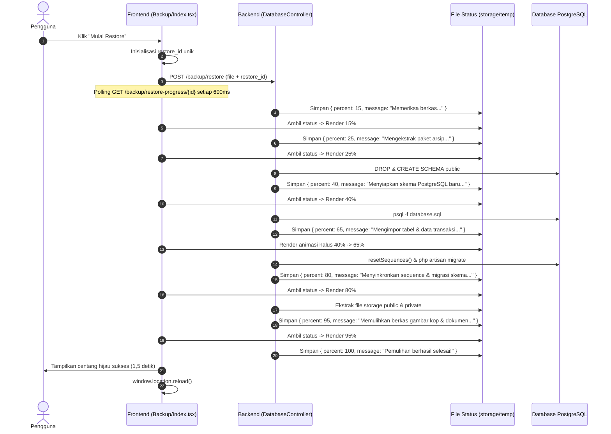

# Design Spec: Pelacakan Progres Nyata (Real-Time Progress) pada Modal Restore Database

## 1. Metadata
- **Tanggal**: 2026-11-11
- **Topik**: Indikator Progres Real-Time Dinamis Berbasis Langkah Server pada Pemulihan Basis Data & Berkas
- **Status**: Validated & Approved by User

---

## 2. Masalah yang Diselesaikan
Sebelumnya pada `resources/js/Pages/Backup/Index.tsx`:
- Event `onProgress` pada `router.post` Inertia.js hanya membaca ukuran byte transmisi HTTP dari browser ke server web lokal.
- Pengunggahan file selesai sangat cepat (< 1 detik), sehingga persentase di modal langsung melonjak ke **100%**.
- Padahal proses pemulihan database (ekstraksi ZIP, drop/create schema, eksekusi `psql`, sinkronisasi sequence, migrasi database, dan pemulihan berkas fisik storage) membutuhkan waktu pemrosesan 5 – 25 detik berikutnya di sisi backend.
- Pengguna melihat progres bar macet di 100% dan merasa bingung apakah proses sedang berjalan atau mengalami kendala (*freeze*).

---

## 3. Sasaran & Kriteria Keberhasilan
1. **Pelacakan Nyata Server (Real-Time State Polling)**: Progres bar bergerak dinamis sesuai dengan tahapan kerja aktual yang sedang dijalankan server backend.
2. **Indikator Langkah yang Informatif**: Menampilkan teks keterangan langkah yang jelas di bawah progress bar (misal: "Memeriksa berkas...", "Menyiapkan skema database...", "Mengimpor data tabel...", "Memulihkan berkas fisik...").
3. **Ketahanan Status dari Pembersihan Skema Database**: File status pelacakan disimpan berbasis file JSON temporer di `storage/app/temp/restore_progress_{restoreId}.json` sehingga kebal terhadap perintah `DROP SCHEMA public CASCADE`.
4. **Animasi Berdenyut & Mulus**: Progres bergerak secara mulus di setiap rentang tahapan tanpa melompat kaku.
5. **Jeda Konfirmasi Sukses 1,5 Detik & Auto-Reload**: Saat proses tuntas 100%, modal menampilkan ikon centang hijau selama 1,5 detik sebelum otomatis me-reload halaman untuk memperbarui seluruh data antarmuka.
6. **Penanganan Error Terbuka di Modal**: Jika terjadi error di backend, progress bar berubah menjadi merah, polling berhenti, dan pesan error dari server disajikan di dalam modal bersama tombol Tutup.

---

## 4. Alur Kerja & Komunikasi Data



---

## 5. Rincian Teknis Implementasi

### A. Rute & Backend (`app/Http/Controllers/DatabaseController.php`)
1. **Endpoint Polling**:
   - `GET /backup/restore-progress/{restoreId}`:
     Membaca file `storage/app/temp/restore_progress_{restoreId}.json` dan mengembalikan JSON:
     ```json
     {
       "percent": 65,
       "message": "Mengimpor tabel & data transaksi ke database...",
       "status": "processing"
     }
     ```
2. **Helper Method `updateRestoreProgress($restoreId, $percent, $message, $status = 'processing')`**:
   - Menulis status ke file temporer.
3. **Penyisipan Status di `restore(Request $request)`**:
   - 10%: Validasi file & kesiapan executable
   - 25%: Ekstraksi berkas arsip .rsv
   - 40%: Pembersihan dan penyiapan schema `public` baru
   - 65%: Impor data tabel via `psql`
   - 80%: Sinkronisasi sequence ID & migrasi skema
   - 95%: Ekstraksi dan penataan berkas fisik kop surat & dokumen
   - 100%: Status selesai
   - Error: Tangkap exception, tulis status `error` dengan pesan kesalahan detail.

### B. Frontend (`resources/js/Pages/Backup/Index.tsx`)
1. **State Pelacakan**:
   - `restoreId`: string unik per sesi restore.
   - `restoreStatus`: `'idle' | 'uploading' | 'processing' | 'completed' | 'error'`.
   - `restoreMessage`: string teks langkah aktif.
   - `restorePercent`: number (0 s/d 100).
2. **Interval Polling**:
   - Berjalan setiap 600ms via `axios.get(route('backup.restore-progress', restoreId))`.
   - Menyesuaikan bar persentase secara proporsional.
   - Jika status `'completed'`, tampilkan ikon centang hijau, tahan selama 1,5 detik, lalu panggil `window.location.reload()`.
   - Jika status `'error'`, hentikan interval, ubah bar menjadi merah, dan tampilkan pesan kesalahan di dalam modal.
