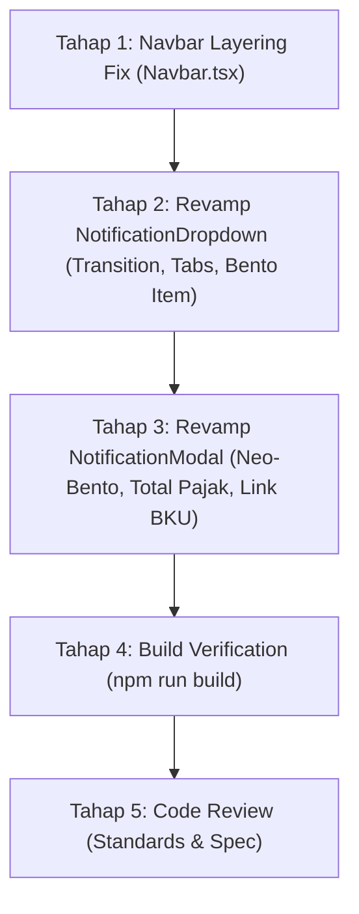

# Implementation Plan: Perbaikan UI & Layering Notifikasi SIKAS Neo-Bento

**Tanggal Rencana:** 12 November 2026  
**Status:** Siap Dieksekusi  
**Dokumen Desain Referensi:** [`docs/superpowers/specs/2026-11-12-notification-ui-layering-design.md`](file:///c:/laragon/www/newSIKAS2/newSIKAS/docs/superpowers/specs/2026-11-12-notification-ui-layering-design.md)  
**Tujuan:** Memperbaiki masalah menu popover notifikasi yang tertutup oleh PageHeader di Navbar, serta meningkatkan tampilan UI `NotificationDropdown` dan `NotificationModal` agar selaras dengan estetika Neo-Bento.

---

## 1. Rincian File & Tahapan Eksekusi

### Tahap 1: Navbar Layering & Stacking Context Fix
**File:** `resources/js/Components/Navbar.tsx`
- Menambahkan kelas `relative z-20` pada elemen `<header>` di dalam Navbar.
- Menambahkan kelas `relative z-10` pada kontainer `{header && (
)}`.
- Memastikan tidak ada benturan visual pada menu dropdown lain (misal: menu profil pengguna).

### Tahap 2: Revamp UI `NotificationDropdown.tsx`
**File:** `resources/js/Components/NotificationDropdown.tsx`
1. **Headless UI Transition**:
   - Membungkus popover dengan `<Transition>` (Headless UI) untuk efek scale, fade, dan slide yang mulus saat dibuka/ditutup.
2. **Header & Aksi**:
   - Menampilkan judul "Notifikasi" dengan tipografi tajam.
   - Badge counter pill `[N] Baru` dengan warna brand/pastel lavender.
   - Tombol "Tandai semua dibaca" (`CheckCheck` icon dari `lucide-react`) yang menandai semua notifikasi `setor_pajak` ke `localStorage`.
3. **Filter Tabs**:
   - State `activeTab: 'all' | 'terima' | 'setor'`.
   - Mini pill tab button untuk memfilter tampilan daftar.
4. **Bento Item Card**:
   - Card item dengan rounded-xl, padding proporsional, dan efek hover lembut.
   - Icon avatar:
     - `terima_pajak`: Icon peringatan segitiga dengan latar pastel amber.
     - `setor_pajak`: Icon centang dengan latar pastel emerald.
   - Label judul, deskripsi bulan/tahun, jumlah transaksi, dan dot indicator unread.
5. **Empty State**:
   - Tampilan bersih saat tidak ada notifikasi aktif untuk kategori terpilih.

### Tahap 3: Revamp UI `NotificationModal.tsx`
**File:** `resources/js/Components/NotificationModal.tsx`
1. **Desain Neo-Bento Modal**:
   - Mengganti gaya Tailwind lawas (`gray-*`, `indigo-*`) menjadi palet modern SIKAS (`slate-*`, `brand-*`, `#15131F`).
2. **Ringkasan Total Pajak**:
   - Kartu highlight di atas tabel yang menghitung dan menampilkan total akumulasi nominal pajak pada bulan tersebut (`Rp XX.XXX.XXX`).
3. **Tabel Data Rapi**:
   - Format rupiah rapi, tipografi tabular, zebra striping halus atau border halus.
4. **Tombol Navigasi Pintas ke BKU**:
   - Tombol "Buka BKU [Bulan]" menggunakan `useVariantRoute('bku', { tahun: notification.year, bulan: notification.month })`.
   - Menutup modal dan langsung mengarahkan bendahara ke transaksi BKU bulan tersebut.

### Tahap 4: Verifikasi & Build
1. Menjalankan `npm run build` (`tsc && vite build`) untuk memverifikasi tipe TypeScript dan kompilasi Vite.
2. Memastikan tidak ada regresi pada halaman Dashboard maupun halaman lain.

### Tahap 5: Code Review (Standards & Spec)
1. Memeriksa diff terhadap coding standards dan arsitektur repositori SIKAS (`AGENTS.md`).
2. Memastikan semua kebutuhan spesifikasi telah terpenuhi.

---

## 2. Diagram Alur Eksekusi

