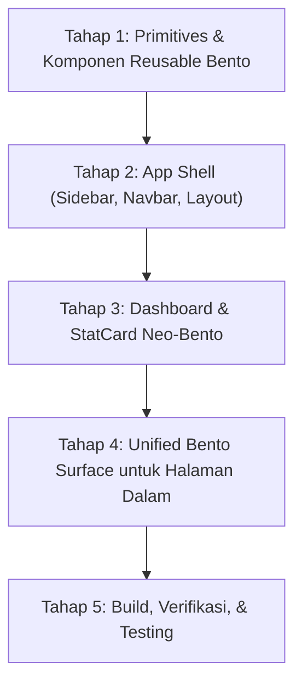

# Implementation Plan: SIKAS Neo-Bento Executive Dashboard & App Shell UI Redesign

**Tanggal Rencana:** 12 November 2026  
**Status:** Siap Dieksekusi  
**Dokumen Desain Referensi:** [`docs/superpowers/specs/2026-11-12-sikas-neo-bento-dashboard-ui-design.md`](file:///c:/laragon/www/newSIKAS2/newSIKAS/docs/superpowers/specs/2026-11-12-sikas-neo-bento-dashboard-ui-design.md)  
**Tujuan:** Memperbarui antarmuka (UI) SIKAS mengadopsi estetika Neo-Bento Eduplex (modern, interaktif, penuh animasi, tersusun rapi) tanpa mengubah logika atau alur data apapun.

---

## 1. Rincian Perubahan File & Tahapan Eksekusi

### Tahap 1: Primitives & Komponen Reusable Bento
1. **Utility & Token Styling (`resources/css/app.css`)**:
   - Menambahkan utility scoped `.bento-card`, `.bento-table`, `.pill-tab`.
   - Mengintegrasikan styling scrollbar halus dan animasi hover kursor.
2. **Komponen `BentoCard` (`resources/js/Components/Bento/BentoCard.tsx`)**:
   - Komponen kontainer kartu bento dengan sudut `rounded-3xl` (28px), border presisi, efek 3D Cursor Tilt saat hover, dan dukungan dark mode.
3. **Komponen `ArkasQuickSyncCard` (`resources/js/Components/Bento/ArkasQuickSyncCard.tsx`)**:
   - Kartu promo/pintas bergaya Eduplex "Go Premium" dengan gradien Royal Violet, kurva estetis, indikator status koneksi ARKAS, dan tombol aksi "Sinkron Sekarang".
4. **Komponen `CalendarWidget` (`resources/js/Components/Bento/CalendarWidget.tsx`)**:
   - Widget kalender bulanan interaktif bergaya Eduplex dengan penanda tanggal aktif lingkaran ungu dan indikator jadwal BOSP.

### Tahap 2: App Shell (Sidebar, Navbar, AuthenticatedLayout)
1. **Sidebar (`resources/js/Components/Sidebar.tsx`)**:
   - Mengubah palet sidebar menjadi Dark Charcoal pekat (`#0D0F17`) dengan border kanan `border-white/5`.
   - Memperbarui menu `NavLink` menjadi pil kapsul membulat (`rounded-2xl`). Item aktif menggunakan Royal Violet (`#7C5CFF`) dengan bayangan halus `shadow-glow-violet`.
   - Menata ulang accordion submenu dengan animasi expand/collapse yang lebih mulus.
   - Menambahkan kartu mini ARKAS di bagian bawah sidebar (gaya kartu "Download mobile app" pada referensi Eduplex).
2. **Navbar / Header (`resources/js/Components/Navbar.tsx`)**:
   - Menampilkan sapaan personal: "Selamat Datang, [Nama Pengguna] 👋" serta nama sekolah.
   - Menata ulang search input menjadi kapsul rounded-full dengan shortcut kursor.
   - Menyelaraskan tombol Dark Mode Switcher, Fullscreen Switcher, dan Copilot Drawer.
3. **Authenticated Layout (`resources/js/Layouts/AuthenticatedLayout.tsx`)**:
   - Memastikan latar belakang kanvas utama menggunakan `#F6F8FC` (dark: `#0B0A12`) sehingga kartu bento tampil mengambang kontras.

### Tahap 3: Metrik & Dashboard Utama
1. **StatCard (`resources/js/Components/StatCard.tsx`)**:
   - Memperbarui kartu metrik menjadi bento card modern dengan kontainer ikon pastel lembut, persentase tren, efek 3D tilt, dan angka beranimasi naik (`useCountUp`).
2. **Dashboard (`resources/js/Pages/Dashboard.tsx`)**:
   - **Header Kontrol**: Styling dropdown tahun & varian anggaran menjadi pill container modern.
   - **Grid Baris 1**: 4 StatCard Bento (Pagu, Realisasi, Saldo Bank, Saldo Kas).
   - **Grid Baris 2 Kiri (8 Kolom)**:
     - Grafik Realisasi Bulanan (Hours Activity Style) dengan ApexCharts bar rounded, highlight bar aktif, dan custom tooltip.
     - Pemanfaatan SNP / Program (Course You're Taking Style) dengan indikator progress donut melingkar.
   - **Grid Baris 2 Kanan (4 Kolom)**:
     - Kartu Pintas ARKAS Sync.
     - Widget Kalender Keuangan.
     - Daftar Transaksi Terakhir (Assignments Style) dengan status badge pastel (`Lunas`, `Draft`, `Proses`).

### Tahap 4: Unified Bento Surface System untuk Halaman Dalam
- Memastikan wrapper layout dan CSS global memberikan ruang napas bento untuk halaman-halaman tabel internal (RKAS, BKU, Laporan).

### Tahap 5: Pengujian & Verifikasi Kualitas
1. Menjalankan `npm run build` (`tsc && vite build`) untuk verifikasi integritas kode dan manifes.
2. Menguji request HTTP dan memastikan status 200 OK.
3. Memastikan semua animasi mati dengan rapi saat `prefers-reduced-motion` aktif.

---

## 2. Rencana Eksekusi Berurutan

